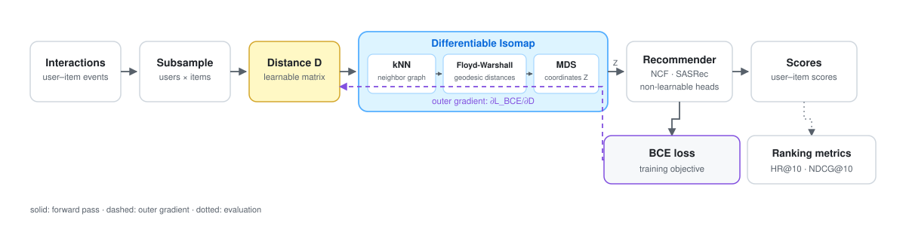

<h1 align="center">Learned Item Manifolds for Recommendation</h1>

<p align="center">
  <b>Reproduction code</b> for<br>
  <i>Revisiting the Hyperbolic Hypothesis in Recommender Systems:<br>
  Is Learned Geometry Better Than Fixed Curvature?</i>
</p>

<p align="center">
  <a href="#quick-start">Quick start</a> ·
  <a href="#reproducing-an-experiment">Reproduce</a> ·
  <a href="docs/README.md">Docs</a> ·
  <a href="https://github.com/ITMO-NSS-team/WWW2027_recsys_manifolds">GitHub</a> ·
  <a href="#citation">Cite</a>
</p>

<p align="center">
  
  
</p>

<p align="center"><sub>Manuscript under review · code and results public</sub></p>

> **Headline result.** A geometry learned jointly with the recommender matches
> or beats the Euclidean baseline in **12 of 15** dataset–scale cells by HR@10
> and **10 of 15** by NDCG@10. Fixed hyperbolic coordinates never beat
> Euclidean for any parametric backbone. The learned space is neither flat nor
> hyperbolic: it becomes locally more negatively curved, acquires cycles, and
> separates into regions that never disconnect. How far it moves is set by the
> dataset, not by the architecture.

## Overview

Most recommenders fix their geometry before training: Euclidean by default, or
a Poincaré ball with a hand-picked curvature. Both impose one global geometry
on a dataset whose neighbourhoods need not share the same local structure.

This repository learns the geometry instead. A differentiable Isomap layer
exposes the item–item distance matrix `D` as a free parameter; an outer loop
differentiates the training loss (BCE) into `D`, while an inner loop trains
the recommender on the resulting coordinates `Z`. The same geometry can feed a
parametric model (NeuMF/NCF, SASRec) or a parameter-free scorer (ItemKNN,
Rocchio-style barycentres).

<p align="center">
  <a href="docs/assets/pipeline.svg"></a>
</p>

HR@10 and NDCG@10 are evaluation metrics; validation HR@10 selects the
checkpoint. The outer gradient comes from the BCE training loss.

The hyperbolic baseline is matched to every competing arm in loss, context
length and embedding dimension; all arms share the same data and evaluation
protocol. The resulting manifolds are measured with curvature, spectral,
isometry and persistent-homology diagnostics. This is a research reproduction
package, not a library: numerical fidelity to the published runs outranks API
stability.

### At a glance

- **Models:** NeuMF/NCF, SASRec, HypSASRec, non-parametric (non-learnable) heads (`item_knn`, `bary_cos`, `bary_euclid`).
- **Geometries:** learned bilevel Isomap, fixed Euclidean, fixed Poincaré, HypSASRec-style hyperbolic.
- **Data:** MovieLens-1M and four Amazon Reviews 2023 categories (Beauty, Arts & Crafts, Grocery, Office).
- **Scales:** 300×800, 1000×1200, 3000×2500 (5 datasets × 3 scales × 3 seeds for SASRec; NCF on ML-1M and Beauty); 6000×3000 extension on selected arms.
- **Diagnostics:** Ollivier–Ricci curvature, Laplacian spectrum, isometry (Kruskal stress, Spearman ρ), persistent homology (H0/H1), Gromov δ.

Training needs a CUDA GPU. Analysis and plotting run on CPU from saved
artefacts; per-run diagnostics CSVs are regenerated, not shipped.

## Installation

```bash
git clone https://github.com/ITMO-NSS-team/WWW2027_recsys_manifolds.git
cd WWW2027_recsys_manifolds
python -m venv .venv
source .venv/bin/activate            # Windows: .venv\Scripts\activate
pip install -r requirements.txt
```

Analysis scripts tested with Python 3.13 and PyTorch 2.14 (CPU). Training
requires a CUDA build of PyTorch.

If `gudhi` or `POT` fail to install, check that your Python version has
prebuilt wheels for them.

## Quick start

Datasets are not in the repository; [`data/README.md`](data/README.md) has
links and the expected layout.

| I want to... | Needs | Command |
|---|---|---|
| Check the install | CPU only, no data | `python figures/plot_hyperbolicity_and_quality_by_scale.py` |
| Retrain one arm | GPU + datasets | `python sasrec/arms/arm_sasrec_latent32_beauty_3000x2500_seed0.py` |
| Run any SASRec cell | GPU + datasets | `python sasrec/arms/arm_sasrec_latent32_any_dataset_scale_seed.py --dataset beauty --scale 3000x2500 --seed 0` |
| Inspect the non-parametric grid | CPU only | `python ncf_fast_and_nonparametric/arms/arm_nonparametric_head_grid.py --list` |

The first command renders `figures_out/hyperbolicity_scaling_comparison.png`
from the tables shipped in `results/`. The last one prints the grid; add
`--dry-run` to preview commands for a subset without running them.

Any script can be run from any working directory: each imports `repo_paths`,
which puts every source directory on `sys.path` and resolves all inputs and
outputs.

## Repository layout

| Path | Contents |
|---|---|
| `repo_paths.py`, `requirements.txt` | paths and dependencies |
| `docs/` | [documentation index](docs/README.md) and [code map](docs/CODE_MAP.md) |
| `data/README.md` | the five datasets: links and expected layout |
| `manul/` | vendored subset of the MANUL library: differentiable Isomap + kernel PCA |
| `shared/` | data preparation used by both model families |
| `sasrec/` | SASRec: architectures, trainer, pipeline, baselines, `arms/` |
| `ncf/` | NeuMF/NCF: same structure; produced the Amazon Beauty GI-NCF results |
| `ncf_fast_and_nonparametric/` | second NCF pipeline: ML-1M GI-NCF and the non-parametric heads |
| `analysis/` | metrics, geometry and topology diagnostics, tables |
| `figures/` | scripts that produce every figure in the paper |
| `results/` | computed artefacts: measures and tables (see [`results/README.md`](results/README.md)) |

> **Two NCF pipelines are not interchangeable.** They do not subsample a
> dataset to the same cells: `ncf/` produced the Amazon Beauty GI-NCF results,
> `ncf_fast_and_nonparametric/` produced the ML-1M GI-NCF and non-parametric
> grids. Reproduce a published number with the pipeline that produced it.
> Details in [`docs/CODE_MAP.md`](docs/CODE_MAP.md).

## Where things are read and written

`repo_paths.py` is the single place paths are defined. Every root is
overridable by an environment variable, which is how you move heavy
directories off the checkout:

| Constant | Env var | Default | Holds |
|---|---|---|---|
| `DATA_DIR` | `RM_DATA_DIR` | `data/` | the five raw datasets |
| `RUNS_DIR` | `RM_RUNS_DIR` | `runs/` | logs, `matrices_epoch*.npz` snapshots, checkpoints, result JSONs |
| `EXTERNAL_RUNS_DIR` | `RM_EXTERNAL_RUNS_DIR` | `external_runs/` | run trees produced on another machine; read-only |
| `RESULTS_DIR` | `RM_RESULTS_DIR` | `results/` | diagnostics, tables, measures |
| `FIGURES_OUT_DIR` | `RM_FIGURES_DIR` | `figures_out/` | rendered figures |

`TABLES_DIR`, `DIAGNOSTICS_DIR` and `MEASURES_DIR` are subdirectories of
`RESULTS_DIR`. Training outputs go under `RUNS_DIR`; analysis writes tables and
diagnostics under `RESULTS_DIR`; figures go to `FIGURES_OUT_DIR`. `runs/`,
`external_runs/` and `figures_out/` are gitignored; under `results/`, only
`diagnostics/` is ignored.

## Reproducing an experiment

1. **Install and download** — `requirements.txt`, then [`data/README.md`](data/README.md).
2. **Train one arm** — e.g. `python sasrec/arms/arm_sasrec_latent32_ml1m_1000x1200_seed0.py`. The run writes `runs/sasrec/logs_sasrec_isomap/<n_run>/` (per-epoch `matrices_epoch*.npz`, `history.json`, the restored-best checkpoint) and `runs/results_<n_run>.json` with test HR@10 / NDCG@10.
3. **Train the comparison arms** — `sasrec/baseline_sasrec_classic_euclidean.py` (Euclidean), `sasrec/baseline_sasrec_poincare_data_curvature.py` (Poincaré), `sasrec/baseline_sasrec_hyperbolic_hypsasrec.py` (hyperbolic); dump the Euclidean geometry with `sasrec/baseline_sasrec_euclidean_geometry_dump.py`.
4. **Compute diagnostics** — matching `analysis/compute_diagnostics_*.py` walker; one CSV per run in `results/diagnostics/`.
5. **Aggregate** — `analysis/table_geometry_before_after_summary.py`, `analysis/table_topology_before_after.py`, `analysis/table_sasrec_arm_metric_statistics.py`.
6. **Plot** — scripts in `figures/`; output in `figures_out/`.

HR@10 and NDCG@10 are computed inside the pipeline and appear in both the log
and the result JSON — no separate metric script is needed. Steps 4–6 run on
CPU and read only saved artefacts, so the analysis can be re-run without
touching the GPU.

## Known pitfalls

These have produced wrong numbers or invalid statistics before. Details in
[`results/README.md`](results/README.md).

- **Do not pool runs with different outer step size `eta`.** Large `eta` is not
  "the same search, faster": several measures move in the opposite direction.
- **`h1_count = -1` means "skipped", not "zero cycles".** Persistent homology
  bails out above `max_simplices = 300_000`; filter on `>= 0` before aggregating.
- **A truncated diagnostics CSV is never repaired automatically.** The walkers
  skip any run that already has a CSV; move the file aside and rerun.
- **Small scales cannot carry claims on their own.** A trivial
  anti-popularity ranker scores far above chance at the smallest scale; see
  `analysis/popularity_baseline_*.py`.
- **Gromov δ is only defined on a metric space.** Report it on `D_geodesic`
  or `D_latent`, not on the free parameter `D_input`.

## Not included

| Item | Why / how to get it |
|---|---|
| Raw datasets | Download links and layout in [`data/README.md`](data/README.md) |
| Per-run diagnostics CSVs (~1.3 GB) | Regenerate with `analysis/compute_diagnostics_*.py` |
| Training artefacts (logs, snapshots, checkpoints) | Output of step 2; too large to distribute |
| Unused MANUL modules | Only the Isomap layer and its kernel-PCA dependency are vendored |

## Citation

```bibtex
@unpublished{revisiting-hyperbolic-2026,
  title  = {Revisiting the Hyperbolic Hypothesis in Recommender Systems:
            Is Learned Geometry Better Than Fixed Curvature?},
  author = {Anonymous},
  year   = {2026},
  note   = {Manuscript under review},
  url    = {https://github.com/ITMO-NSS-team/WWW2027_recsys_manifolds}
}
```

## Acknowledgements

Datasets: [MovieLens-1M](https://grouplens.org/datasets/movielens/1m/)
(GroupLens) and [Amazon Reviews 2023](https://amazon-reviews-2023.github.io/)
(McAuley Lab). The hyperbolic baseline follows the HypSASRec procedure.
